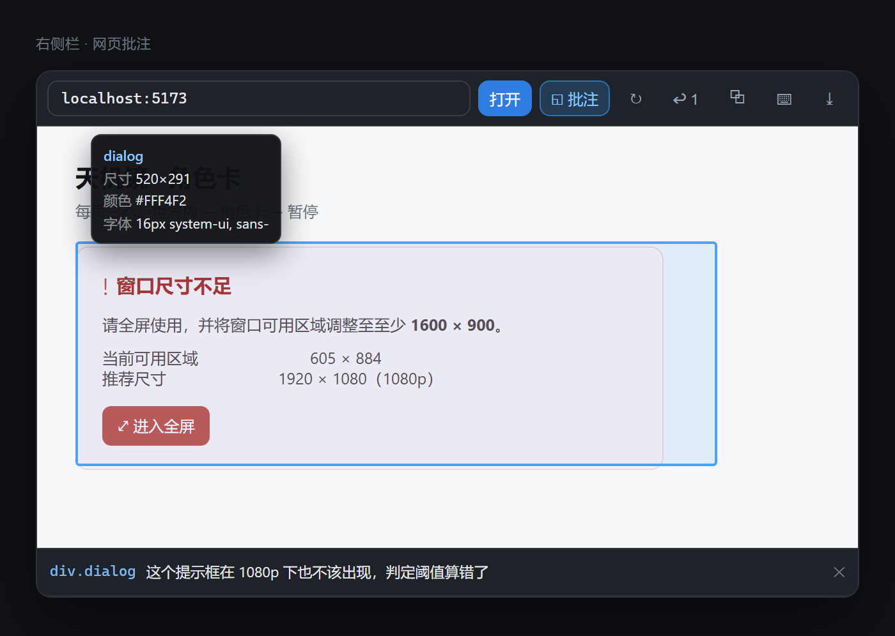

# dsh-web-annotate

在 DSH 侧栏里跑一个真实浏览器，指向页面元素就地写批注，汇总成结构化指令。

Point at a live element inside the DSH sidebar, drop a comment on it, and get back a structured instruction list.

[](LICENSE)
[](https://github.com/deepseek-ai/deepseek-harness)
[](https://github.com/topics/dsh-plugin)

---



> 图为界面示意，按插件 `lib/client.js` 的工具栏、拾取高亮、元素信息与批注列表样式渲染，页面内容为假数据，不是运行截图。可用 `node scripts/make-screenshots.mjs` 重新生成（源码在 `scripts/demo/annotate.html`）。

## 它解决什么问题

改界面最累的不是改，是指路。「左边那个卡片的边距大了点」——模型得猜是哪个卡片；截一张图贴进去——又得反复圈。批注把指路变成点一下：鼠标停在哪个元素上，它的标签、尺寸、背景色、字体就摆在那儿，点一下写一句人话，最后汇总成一份带选择器的清单。

## 功能

- **真实浏览器**：宿主侧用 Playwright 起 Chromium，页面是真跑的，不是画出来的缩略图。
- **画面推流**：CDP `Page.startScreencast` 出帧，SSE 推到侧栏，页面一有变化就刷新。
- **元素拾取**：开启批注模式后，鼠标指向哪里，就高亮哪个元素并显示 `标签 / 尺寸 / 背景色 / 字体 / 字号 / 字重`。
- **就地评论**：点元素弹出输入框，回车即存；批注列表在下方可逐条删除。
- **框选区域**：按住拖动可以框一块区域批注，适合「这一整块间距不对」这类说不清是哪个元素的意见。
- **一键回填**：点 **↩** 把汇总直接写进对话输入框，不用复制粘贴。
- **快捷键**：`Ctrl+Shift+.` 切换批注模式。
- **交互转发**：退出拾取后，点击、滚轮、方向键、Enter、Tab、Esc、Backspace、PageUp/PageDown 都会转发给页面。
- **批注留得住**：按页面地址存在 `localStorage`，关掉 tab 再打开还在；删完自动清空。
- **穿透 iframe**：页面里嵌的 iframe（含跨域）也能点进去拾取，信息浮层会标出所在层级。
- **页面内输入**：工具栏 `⌨` 把一段文本（含中文）送进页面当前焦点元素，绕开键盘布局与输入法。
- **导出成文件**：`⤓` 把汇总写成 Markdown，存到 `~/.dsh/web-annotate/` 下。

## 汇总长这样

```markdown
## 网页批注

页面：http://localhost:5173/

1. `#card-a`（div，936×54）
   卡片内边距太大，收到 12px

2. `#card-b.accent`（div，936×54）
   强调色换成主题蓝
```

## 用法

1. 点右侧栏 tab 条的添加按钮，选 **网页批注**。
2. 地址栏输入 `localhost:5173`，回车。首次启动浏览器要等几秒。
3. 点工具栏的 **◱ 批注**（或按 `Ctrl+Shift+.`）进入拾取模式。指向元素看信息，点一下写评论；按住拖动可以框一块区域。
4. 点 **↩** 把汇总回填到输入框，或点 **⧉** 复制到剪贴板。

退出拾取模式后，点击和滚轮会正常传给页面，可以当普通预览用。

## 与 dsh-web-preview 的分工

| | dsh-web-preview | dsh-web-annotate |
|---|---|---|
| 渲染 | iframe 直出 | CDP 画面流 |
| 速度 | 接近原生 | 帧流，有几十毫秒延迟 |
| 能否批注 | 否（跨域拿不到 DOM） | 能 |
| 依赖 | 无 | 需要 Playwright（复用 DSH 自带的那份） |

两个插件可以同时装，各自一个 tab 类型。

## 技术实现

```
宿主 lib/index.js
  ├─ 从 DSH profile 目录解析 playwright，复用 DSH 自带的 chromium
  ├─ 每个地址一个 page 会话，CDP screencast 出帧
  ├─ SSE  GET  /api/web-annotate/frames?session=<id>
  ├─ POST /api/web-annotate/session      创建会话
  ├─ POST /api/web-annotate/input        鼠标 / 滚轮 / 键盘转发
  ├─ POST /api/web-annotate/pick         坐标 → 元素信息（elementFromPoint）
  ├─ POST /api/web-annotate/reload       重新加载
  └─ DEL  /api/web-annotate/session/<id> 关闭
```

没用 WebSocket：DSH 的 `webServer` 只暴露路由注册，不保证能拿到 http server 的 `upgrade` 事件。SSE 是普通响应，稳定可控；输入事件走 POST，量级完全够。

选择器生成走 `id` → 类名 → `nth-of-type` 的降级链，最多上溯 6 层。

## 权限与安全边界

这个插件比纯前端插件权限大，装之前请明确知道它做了什么。

- **会启动本地浏览器进程**：使用 DSH 自带的 Playwright 与 Chromium，不额外下载。
- **会访问你输入的地址**：只放行 `http` / `https`，拒绝 `file://` 与其它协议，不能读取本地文件。
- **不注入任意脚本**：页面内只执行一个固定的取元素信息函数，不执行页面返回的内容。
- **不写入文件**：批注只存在客户端内存里，复制由你自己触发。
- **会话隔离**：每个地址一个 page，关闭 tab 即销毁；无客户端连接且空闲 5 分钟后自动回收。
- `dependencies` 为空，无 `preinstall` / `install` / `postinstall` / `prepare` 生命周期脚本。

## 已知限制

- 画面是帧流，快速滚动或动画多时会有轻微延迟。
- 拾取模式会拦截点击与滚动，要操作页面（点按钮、输入）需先退出拾取。
- 键盘只转发导航键与编辑键（方向键、Enter、Tab、Esc、Backspace、PageUp/PageDown）；可打印字符走 `⌨` 面板的整段输入，逐字键入不转。
- 回填依赖 DSH 的 `conversation.input.left` 插槽存在。该插槽没挂上时自动退回复制到剪贴板。
- iframe 穿透最多 4 层；超出的部分会被当成普通 iframe 元素本身。
- 导出固定写到 `~/.dsh/web-annotate/`，不写项目目录。
- 批注存在 `localStorage`，按页面地址分键；换浏览器 profile 或清理站点数据会丢。
- 只在 Windows + DeepSeek Harness `0.2.x` 桌面端验证过。

## 开发与验证

```bash
node scripts/verify.mjs   # 静态 + 路由级，17 项，不启动浏览器
node scripts/smoke.mjs    # 端到端：起站点、起 chromium、取帧、拾取、输入、刷新、关闭，8 项
```

`smoke.mjs` 会真起一个本地 HTTP 站点和 Chromium，实测输出形如：

```
PASS  创建会话并打开页面
      frame=13351 bytes, device=1000x700
PASS  SSE 收到首帧画面
      picked <div> #card-a 936x54
      bg=rgb(255, 255, 255) font=16px / system-ui
PASS  拾取元素返回标签与样式
...
结果: 8 passed, 0 failed
```

## 安装

```bash
dsh plugin --profile desktop add "link:/absolute/path/to/dsh-web-annotate"
```

路径含空格时改为手工方式：在 `profiles/desktop/package.json` 的 `dependencies` 加 `"dsh-web-annotate": "link:E:/path/to/dsh-web-annotate"`，在 `dsh.profile.bundles` 追加 `"dsh-web-annotate"`，并在 `profiles/desktop/node_modules/` 下建指向本目录的 Junction，然后重启 DSH。

## 更新记录

- **0.3.0** — 攻克三处硬限制：拾取可递归穿透 iframe（`frame.childFrames()` 逐层进入子文档，跨域也能读，最多 4 层，浮层显示所在层级）；新增 `⌨` 页面文本输入面板，用 `keyboard.insertText` 送中文等任意字符；新增 `⤓` 导出，把汇总写成 Markdown 到 `~/.dsh/web-annotate/`。自检 19 项，冒烟 11 项。
- **0.2.0** — 批注汇总可直接回填输入框（在 `conversation.input.left` 挂桥接组件拿到 `inputActions`，桥不可用时退回复制）；新增 `Ctrl+Shift+.` 快捷键、拖动框选区域、方向键与编辑键转发、批注 `localStorage` 持久化。自检增至 17 项。
- **0.1.0** — 首个版本。

## 许可证

[MIT](LICENSE)

## 联系

邮箱：**1992335297@qq.com**
